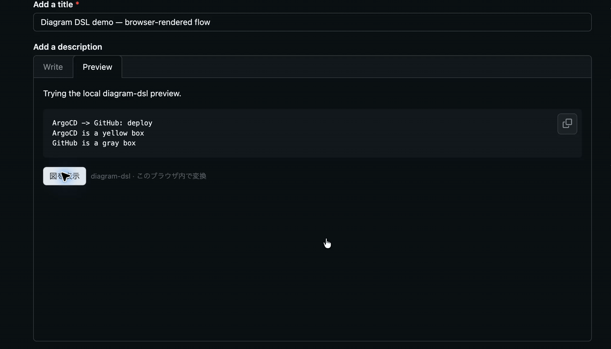

# diagram-dsl

Write a diagram as a few short, fixed statements. The TypeScript compiler turns them into Mermaid, and the browser extension renders selected blocks locally on GitHub and Notion—no conversion server and no page-content upload.

```text
ArgoCD -> GitHub: deploy
ArgoCD is a yellow box
GitHub is a gray box
```

The full language definition, including every supported grammar and its limits, is in [SPEC.md](SPEC.md).

## Supported diagrams

| Diagram | Selection | Examples of what it models |
| --- | --- | --- |
| Flow | Default | Directed/dotted/thick/bidirectional links, shapes, nested groups |
| ER | Inferred from entities and `has` relations | Fields, composite keys, foreign references, unique/optional fields |
| Sequence | `sequence:` | Participants and ordered messages |
| State | `state:` | Transitions, start/end states |
| Class | `class:` | Typed members, inheritance, implementation |
| Mind map | `mindmap:` | Nested ideas |
| Pie | `pie:` | Named numeric slices |
| Gantt | `gantt:` | Tasks with date ranges |
| Timeline | `timeline:` | Events by year |
| User journey | `journey:` | Sections, actors, and 1–5 scores |
| Quadrant | `quadrant:` | Labeled points on normalized axes |

Each non-default type has a small explicit header so an arrow cannot silently change meaning. Unsupported or malformed input returns line-numbered diagnostics instead of guessed output.

## TypeScript API

```ts
import { compile } from "diagram-dsl";

const result = compile(`ArgoCD -> GitHub: deploy\nArgoCD is a yellow box`);
if (result.ok) {
  console.log(result.kind);
  console.log(result.mermaid);
} else {
  console.error(result.diagnostics);
}
```

The compiler API has no runtime imports; Mermaid is bundled only into the browser extension for local rendering.

## Browser extension

Build a loadable Chrome extension:

```sh
npm install
npm run test
npm run build:extension
```

In Chrome, open `chrome://extensions`, enable Developer mode, choose **Load unpacked**, and select `extension/dist`. For Firefox, open `about:debugging#/runtime/this-firefox`, choose **Load Temporary Add-on**, and select `extension/dist-firefox/manifest.json`. Store ZIPs can be made with `npm run package:extension` (Chrome) and `npm run package:extension:firefox` (Firefox).

On GitHub, label a fenced block `diagram-dsl`:

````markdown
```diagram-dsl
ArgoCD -> GitHub: deploy
ArgoCD is a yellow box
GitHub is a gray box
```
````

On Notion, use a code block whose first line is `# diagram-dsl`, followed by the DSL. The extension adds a **図を表示** button; the original block is not rewritten. Enable the extension separately on GitHub or Notion from its toolbar popup. Browser access applies to the chosen supported domain (for example, all of `github.com`); the choice is stored locally and conversion/rendering stays in the browser. Packaging uses the system `zip` command.

## Development

- `npm test` builds the compiler, runs parser/extension tests, and checks every generated diagram with the bundled Mermaid parser.
- `npm run build:extension` builds the unpacked extension in `extension/dist`.
- `npm run package:extension` builds a ZIP from that folder.
- GitHub Actions runs the tests and packages Chrome and Firefox extensions on pushes and pull requests.

The extension targets current Chrome and Firefox and supported GitHub/Notion page DOMs. Those sites can change their markup; manual smoke testing is required when changing block detection. Store submission and signing are not included.

## Real-platform demo

This capture shows the browser extension rendering the DSL in GitHub's issue preview. The issue was left as a draft and was not submitted.



For the release smoke test, load the unpacked extension, enable it for GitHub or Notion from its toolbar popup, then open a page containing an opted-in block. Confirm **図を表示** renders the diagram, the Mermaid source can be expanded, malformed DSL shows a diagnostic, and the original code block remains unchanged. On Notion, create a code block whose first line is `# diagram-dsl`.

## Project status

The v0.2.0 DSL/compiler, local GitHub/Notion extension, tests, Chrome/Firefox packaging, and verified GitHub browser demo are implemented. The GIF above was captured from the real extension workflow; no GitHub issue was submitted.
